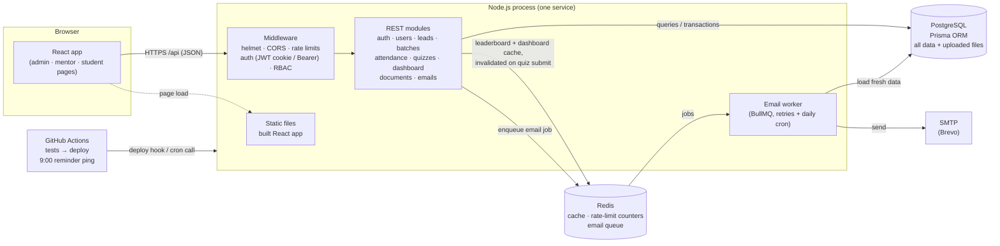

# MiniEdCRM

A small CRM for a training institute: manage leads, convert them into students,
run batches with attendance, and test students with timed quizzes and a leaderboard.
It also covers placements: skill-gap reports, a placement-readiness score per student,
tasks, batch join codes, and a hiring side where recruiters post jobs and campus drives,
run hiring tests and interviews, and browse a talent pool of students who opt in.

## Stack

| Layer    | Tech                                              |
| -------- | ------------------------------------------------- |
| API      | Node.js, Express 5, TypeScript, Zod               |
| Database | PostgreSQL 17 via Prisma ORM                      |
| Cache    | Redis (leaderboard, dashboard stats, rate limits) |
| Queue    | BullMQ on Redis, or on Postgres without Redis (emails with retries) |
| Payments | Razorpay (orders, signed checkout, webhooks); a built-in test gateway in development |
| Email    | Nodemailer over SMTP; saved to `.outbox/` in dev  |
| Frontend | React 19, Vite, Tailwind 4, TanStack Query, Recharts |
| Ops      | Docker Compose, GitHub Actions, HTTPS deploy      |

## Architecture



A request goes through the security middleware (headers, rate limit, session, role check), then a feature module
that validates input with Zod and talks to Postgres through Prisma. Anything slow or flaky, like sending email,
is put on a queue and done by the worker, so requests stay fast and a mail outage never fails an action. Hot reads
(leaderboards, dashboard) come from the cache. Redis is optional: without it the cache and rate limits fall back to
memory and the queue runs on Postgres, which is how the free deployment runs.

## Design decisions

| Decision | Why |
| -------- | --- |
| **Modular monolith** (one Express app, a folder per feature) | One small team, one deploy. Each module has its own routes, Zod schemas and service, so it could be split out later. |
| **PostgreSQL + Prisma** | The data is relational (leads → students → batches → quizzes → attempts) and needs transactions and unique constraints. Prisma gives typed queries and versioned migrations. |
| **One `User` table with a `role` enum** | Admins, mentors and students share login, password reset and sessions. Role checks live in one `requireRole()` middleware. |
| **Enrolling is its own action** (`POST /leads/:id/convert`), not a stage dropdown value | On the lead page, "Enroll as student" asks for the batch, then creates the student account, puts them in a batch and marks the lead `ENROLLED` in **one transaction**, so there's never an enrolled lead without an account. Two admins enrolling at once can't create two accounts. |
| **Append-only activity log** for leads | The timeline is history: stage changes, notes, conversion and reminders are added, never edited. |
| **Server-side quiz timer and grading** | `startedAt` is recorded by the server, answers are never sent before submitting, and scoring happens on the server, so changing the browser clock or reading the page source doesn't help. One attempt per student (a unique key), a 15 s grace period for slow networks. |
| **Cache-aside with explicit invalidation** | Leaderboards and dashboard stats are expensive aggregates read far more often than they change. They're cached (5 min / 60 s) and deleted on every quiz submit; the TTL is only a safety net. |
| **Emails through a queue** (BullMQ) | Sending is slow and can fail. The action saves an `EmailLog` row and queues a job; the worker retries with exponential backoff and records `SENT` / `FAILED`, so admins can see every email. |
| **Rate limits** with fixed windows in Redis | Login (per IP + email, and per IP), signup, password reset, quiz submit (per student), uploads and CSV import. Shared across servers when Redis is there. |
| **httpOnly cookie sessions + CSRF header** | Page scripts can't read the token (XSS can't steal it); cookie writes need `X-Requested-With`, which other sites can't send. `tokenVersion` signs out every session after a password change. |
| **404 instead of 403** for other people's batches and files | Doesn't reveal that an ID exists. |
| **Files checked by their bytes**, stored in Postgres | The extension and the first bytes must agree (a renamed `.exe` is rejected). Storing in the database survives free hosts that wipe the disk. |
| **Indexes follow real queries** | Leads by stage/date, follow-ups due, attendance by batch/date, attempts by quiz/score. |
| **One service in production** | The API serves the built React app, so the site is one address: first-party cookies, no CORS, one free Render service. |
| **CI gates the deploy** | Typecheck, Vitest + Supertest, the 261 end-to-end smoke checks and the Docker build must all pass before GitHub Actions triggers the Render deploy. |

## Project layout

```
miniED/
├── docker-compose.yml   Postgres + Redis for local dev
├── server/              REST API
│   ├── prisma/          schema.prisma and migrations
│   └── src/
│       ├── config/      env validation
│       ├── lib/         shared helpers (prisma, cache, errors, dates, pagination)
│       ├── middleware/  auth, error handling, rate limiting
│       └── modules/     one folder per feature: routes, schemas, service
└── client/              React app (Vite dev server proxies /api to :4000)
```

## Deploying

Free hosting (Render + Neon + Brevo, $0) is described step by step in [DEPLOY.md](DEPLOY.md). In production one
Node process serves the API, the built web app and the email worker:

```bash
npm run build      # from the repo root: builds client/ and server/
npm start          # applies database migrations, then starts the server
```

Production settings (see `server/.env.example`): `NODE_ENV=production`, `CLIENT_URL` (https), `SMTP_URL`,
`TRUST_PROXY=1` behind a proxy, `CRON_SECRET` for the GitHub Action that sends the 9:00 reminders, and optionally
`BCRYPT_ROUNDS=10` on slow free CPUs.

## Running with Docker Compose

Runs the app, Postgres and Redis together:

```bash
docker compose up -d --build                                    # http://localhost:8080
docker compose exec app npm run db:seed                         # first time: admin + demo mentor
```

Sign in with `admin@miniedcrm.test` / `Admin@12345`. Emails are saved inside the container (`/app/server/.outbox`).

## Running locally

Requires Node 22.12+ and Docker Desktop.

```bash
docker compose up -d postgres redis   # start only Postgres and Redis
cd server
cp .env.example .env               # then set JWT_SECRET
npm install
npm run db:migrate                 # create tables
npm run dev                        # API on http://localhost:4000
```

Check it: `GET http://localhost:4000/api/health` should return `{"status":"ok","db":"up"}`.

### Without Docker

If Docker isn't available, `npm run db:local` runs a real Postgres 17 server through the
`embedded-postgres` package, using the same port and credentials as Docker. The database is created as
UTF-8 (Windows would default to WIN1252, which can't store Hindi names or emoji). If yours was made
before this, it prints a warning: `npm run db:local -- --recreate` rebuilds it empty. Keep that terminal
open, then in a second terminal:

```bash
cd server
npm run db:migrate
npm run db:seed                    # creates the first admin + a demo mentor
npm run dev
```

Seed account emails and passwords are set in `.env.example` (`SEED_*`).

To see every feature with data in it, `npm run db:demo` adds a demo institute: mentors, three courses, leads at
every stage, students with attendance, quizzes (skills, negative marking, a practice set), tasks, payments, two
recruiters with jobs, campus drives, applications, interviews and a hiring test. Everything it adds ends in
`@demo.miniedcrm.test` or starts with `DEMO-`; `npm run db:demo -- --remove` takes it all out again. Locally the
demo accounts' password is `Demo@12345!`; for any other database set `DEMO_PASSWORD` first.

Then start the web app in a third terminal and open http://localhost:5173:

```bash
cd client
npm install
npm run dev
```

### Tests

```bash
cd server
npm test                           # Vitest + Supertest: unit and API tests, no server needed
npm run test:smoke                 # 261 end-to-end checks against a running API (npm run dev)
```

`npm test` needs only the database server (Docker or `npm run db:local`). It runs against its own
`miniedcrm_test` database on that server (or `TEST_DATABASE_URL`), creates it and applies the migrations,
and empties it at the start of every run, so your development data is never touched. Redis isn't needed and
no email is sent. See [server/tests/smoke](server/tests/smoke/README.md) for the smoke tests.

**CI.** [.github/workflows/ci.yml](.github/workflows/ci.yml) runs on every push to `main` and every pull request:
typecheck and build of both apps, `npm test`, then the built API is started against a fresh Postgres and
`npm run test:smoke` runs against it, and the Docker image is built. On `main`, when all of that passes, it
triggers the Render deploy (see [DEPLOY.md](DEPLOY.md#6-deploys-from-github-actions)).

Redis is optional while developing: if `REDIS_URL` is missing or unreachable, the API logs
`Cache: ... using in-memory cache` and caches in memory instead, and the email queue uses Postgres.
Production should always use Redis, because the in-memory cache isn't shared between servers.

**Emails in development.** Without `SMTP_URL`, nothing is sent: each email is saved as
`server/.outbox/<id>.eml`, which opens in any mail app. `GET /api/health` shows which cache, queue and
mail backend are in use. By default the API also runs the email worker. To run it separately (as in
production), start the API with `RUN_WORKER=false` and run `npm run worker` in another terminal.

## API

All responses are JSON. Errors always look like `{ "error": string, "details"?: object }`.

**Signing in.** Login, signup and password changes return `{token, user}` and also set an `mecrm_session` cookie
(httpOnly, `SameSite=Lax`, `Secure` in production, path `/api`). The web app uses only the cookie, so page scripts
never see the token. API clients can send `Authorization: Bearer <token>` instead. Requests that use the cookie and
change data must also send `X-Requested-With: miniedcrm`, which other websites can't add (CSRF protection).
`POST /api/auth/logout` clears the cookie.

**Rate limits** (`429` with `Retry-After` and `RateLimit-*` headers; Redis-backed when Redis is connected, else in memory):

| Limit | Allowed |
| ----- | ------- |
| Any API request | 300 per minute per IP (`/api/health` is exempt) |
| Login | 10 per 15 min per IP + email, and 50 per 15 min per IP |
| Signup | 10 per hour per IP |
| Forgot / reset password | 10 per hour per IP |
| Change password | 10 per 15 min per user |
| Quiz submit | 20 per 10 min per student |
| File uploads / CSV imports | 30 / 20 per hour per user |

In development, requests from your own machine skip the limits; set `RATE_LIMIT_LOCAL=true` to test them.
Behind a proxy (Render, Caddy), set `TRUST_PROXY=1` or every visitor shares the proxy's IP and its limits.

**Production checks.** With `NODE_ENV=production` the API refuses to start without `SMTP_URL`, with a non-https
`CLIENT_URL`, or with the example `JWT_SECRET`, and lists what to fix.

| Method | Path                    | Who     | What                                         |
| ------ | ----------------------- | ------- | -------------------------------------------- |
| GET    | `/api/health`           | anyone  | App and DB status                            |
| POST   | `/api/auth/signup`      | anyone  | Create a **student** account → `{token, user}` |
| POST   | `/api/auth/login`       | anyone  | → `{token, user}`                            |
| GET    | `/api/auth/me`          | any role| Current user                                 |
| POST   | `/api/auth/change-password` | any role | `{currentPassword, newPassword}` → new `{token, user}`; other devices are signed out |
| POST   | `/api/auth/forgot-password` | anyone | `{email}` → always the same 200 answer; emails a reset link if the account exists |
| GET    | `/api/auth/reset-password?token=` | anyone | 200 `{email}` if the link still works, else 400 |
| POST   | `/api/auth/reset-password` | anyone | `{token, newPassword}`; signs out every session |
| POST   | `/api/users`            | Admin   | Create a user with any role                  |
| GET    | `/api/users?role=&page=&limit=` | Admin | List users (paginated)              |
| PATCH  | `/api/users/:id/status` | Admin   | `{isActive}` to deactivate or reactivate     |

**Passwords and sessions**
- Each user has a `tokenVersion`, copied into their sign-in token. Changing or resetting the password bumps it,
  which signs out every existing session at once (`401 "Your session has ended"`).
- Reset links are random 32-byte tokens that work once, for 1 hour. Only a SHA-256 hash is stored, a new request
  replaces the old link, and at most one reset email goes out per minute per person. Asking for a reset never
  reveals whether an email has an account.
- Every change or reset sends a "your password was changed" email saying what to do if it wasn't you.

### Leads (Admin only)

| Method | Path                       | What                                                        |
| ------ | -------------------------- | ----------------------------------------------------------- |
| GET    | `/api/leads`               | List. Query: `search`, `stage`, `source`, `assignedToId`, `followUpDue=true`, `sort=newest\|oldest\|name\|followUp`, `page`, `limit` |
| POST   | `/api/leads`               | Create `{name, email, phone?, source?, courseInterest?, nextFollowUpAt?, assignedToId?}` |
| POST   | `/api/leads/import`        | CSV upload (form field `file`, max 2 MB / 5000 rows). See [samples/leads-sample.csv](server/samples/leads-sample.csv) |
| GET    | `/api/leads/:id`           | One lead                                                    |
| PATCH  | `/api/leads/:id`           | Update fields; `assignedToId` / `nextFollowUpAt` accept `null` |
| DELETE | `/api/leads/:id`           | Delete (not allowed once enrolled)                          |
| PATCH  | `/api/leads/:id/stage`     | `{stage, note?}`. Logs to the timeline                      |
| GET    | `/api/leads/:id/notes`     | Notes, newest first                                         |
| POST   | `/api/leads/:id/notes`     | `{body}`                                                    |
| GET    | `/api/leads/:id/timeline`  | Activity log, newest first                                  |

| POST   | `/api/leads/:id/convert`   | `{batchId, password?}`. Creates the student account and enrolls the lead (see below) |

**Lead rules**
- One lead per email (case-insensitive). Duplicates return `409` with `existingLeadId`.
- `ENROLLED` can't be set through `/stage`; enrolling creates a student account, so it goes through `POST /api/leads/:id/convert` (Phase 4). Enrolled leads are locked.
- Moving a lead to `LOST` clears its follow-up date so it stops getting reminders. Lost leads can be reopened.
- CSV import accepts common header names (`E-mail`, `Course Interest`, `Follow Up`...), imports valid rows in one transaction, and reports each skipped row with its row number and reason.

**Converting a lead** runs in one transaction: it creates the STUDENT account (from the lead's name, email and phone),
places them in the batch, marks the lead `ENROLLED`, links the lead to the student and logs `CONVERTED` on the timeline.
If any step fails, nothing changes. If two admins convert the same lead at once, only one succeeds. When no
`password` is sent, a temporary one is generated and sent in the student's welcome email; the response only says
`welcomeEmail: {id, status}`. If the email couldn't even be queued (`status: "FAILED"`), the password is returned once
in the response instead, so the admin can still hand it over.

### Batches

| Method | Path                                   | Who                 | What                                  |
| ------ | -------------------------------------- | ------------------- | ------------------------------------- |
| GET    | `/api/batches`                         | any role            | Admin: all. Mentor: their batches. Student: their own |
| POST   | `/api/batches`                         | Admin               | `{name, course, startDate, endDate?, mentorId?}` (dates `YYYY-MM-DD`) |
| GET    | `/api/batches/:id`                     | any role, if theirs | One batch with mentor and student count |
| PATCH  | `/api/batches/:id`                     | Admin               | Update; `endDate` / `mentorId` accept `null` |
| GET    | `/api/batches/:id/students`            | Admin, its mentor   | Student roster                        |
| POST   | `/api/batches/:id/students`            | Admin               | `{studentId}`: add or move a student  |
| DELETE | `/api/batches/:id/students/:studentId` | Admin               | Remove a student from the batch       |

A batch the user can't access returns `404`, not `403`, so batch IDs can't be discovered by guessing.

### Attendance

| Method | Path                                   | Who               | What                                          |
| ------ | -------------------------------------- | ----------------- | --------------------------------------------- |
| PUT    | `/api/batches/:id/attendance`          | Admin, its mentor | `{date, records: [{studentId, status}]}` marks a whole day |
| GET    | `/api/batches/:id/attendance?date=`    | Admin, its mentor | Roster for that day; `status: null` = not marked |
| GET    | `/api/batches/:id/attendance/summary`  | Admin, its mentor | Each student's %, plus the batch average       |
| GET    | `/api/attendance/me`                   | Student           | Own counts, %, and the last 30 days            |

- Status is `PRESENT`, `LATE` or `ABSENT`. **LATE counts as attended:** % = (present + late) / days marked.
- Marking the same day again updates it (one record per student per day).
- No future dates, no dates outside the batch's start/end, and every student must belong to the batch.

### Quizzes

| Method | Path                            | Who                     | What                                        |
| ------ | ------------------------------- | ----------------------- | ------------------------------------------- |
| GET    | `/api/quizzes?batchId=`         | any role                | Managers: their batches' quizzes. Students: published quizzes in their batch, with `myAttempt` |
| POST   | `/api/quizzes`                  | Admin, batch mentor     | Create a draft `{batchId, title, description?, durationSeconds, questions?}` |
| GET    | `/api/quizzes/:id`              | Admin, batch mentor     | Full quiz including correct answers         |
| PUT    | `/api/quizzes/:id`              | Admin, batch mentor     | Replace a draft (title, settings, all questions) |
| POST   | `/api/quizzes/:id/publish`      | Admin, batch mentor     | Publish (needs at least 1 question; locks editing) |
| DELETE | `/api/quizzes/:id`              | Admin, batch mentor     | Only if nobody has attempted it             |
| GET    | `/api/quizzes/:id/attempts`     | Admin, batch mentor     | Every attempt with status and score         |
| POST   | `/api/quizzes/:id/start`        | Student in the batch    | Starts the timer (or resumes) → questions without answers, `expiresAt` |
| POST   | `/api/quizzes/:id/submit`       | Student in the batch    | `{answers: [{questionId, optionId|null}]}` → score and review |
| GET    | `/api/quizzes/:id/result`       | Student                 | Own score and answer review                 |
| GET    | `/api/quizzes/:id/leaderboard`  | Managers + batch students | Ranked by score, then time taken (cached) |
| GET    | `/api/batches/:id/leaderboard`  | Anyone who can see the batch | Total score across the batch's quizzes (cached) |

| GET    | `/api/quizzes/:id/practice`     | Student in the batch    | A practice quiz's questions and your previous goes |
| POST   | `/api/quizzes/:id/practice`     | Student in the batch    | `{answers, timeTakenMs?}` → score, review with explanations; as often as you like |

Question format: `{text, points?, skill?, explanation?, options: [{text, isCorrect}]}`. 2–6 options, **exactly one** correct.
Quiz settings: `mode` (`TEST` or `PRACTICE`), `negativePercent` (0–100), `passPercent` (1–100 or null),
`opensAt` / `closesAt` (optional start window). A quiz has a `batchId`, or a `jobId` for a recruiter's hiring test.

**Marking**
- Right: + the question's points. Wrong: − `negativePercent`% of them. **Skipped: 0**, so guessing can't fake a score. The total never goes below 0.
- With a `passPercent`, results say passed or not. Each question's `explanation` is shown in the review after submitting.
- `PRACTICE` quizzes have no server timer, any number of goes (stored as `PracticeRun`), and never reach a leaderboard.
- Each question's `skill` feeds the skill-gap report (`/api/progress/skills`): accuracy per skill, under 50% is a gap, 75%+ a strength.

**How a timed attempt works**
1. `start` records `startedAt` on the server. The server's clock is the only one that counts, so changing the browser clock does nothing.
2. Students never receive `isCorrect` until they've submitted.
3. `submit` is graded on the server. Unanswered questions count as wrong. One attempt per student per quiz, and a double submit only scores once.
4. Submissions later than `durationSeconds` + **15 s grace** are marked `EXPIRED` with score 0. Submissions inside the grace window count, with time taken capped at the limit.

**Leaderboard caching**
- Both leaderboards are cached for 5 minutes under `lb:quiz:<id>` and `lb:batch:<id>`.
- Every successful submit deletes both keys (and `dashboard:stats`), so the next read rebuilds fresh data. The TTL is only a safety net.
- Responses carry `X-Cache: HIT` or `MISS`. One cached copy is shared by every viewer, so it contains names only, never emails.
- Ranking uses competition style: equal score and time share a rank (1, 2, 2, 4).

### Student progress (Student only)

| Method | Path                        | What |
| ------ | --------------------------- | ---- |
| GET    | `/api/progress/quizzes`     | Every finished attempt: marks, %, time, rank among classmates and class average; plus average, best and first places |
| GET    | `/api/progress/attendance`  | Every marked day, present/late/absent counts, %, current and longest streak |
| GET    | `/api/progress/time`        | Learning time: class time (attended days × the batch's `classMinutes`) plus measured quiz time, total and per week for 12 weeks |
| GET    | `/api/progress/skills`      | Accuracy per skill across submitted tests, weakest first, with gaps and strengths |

Batches have an optional `classMinutes` (class length per day, 15–600). Without it, class time isn't guessed: the
time page shows the days attended and says the class length isn't set.

### Tasks and join codes

| Method | Path | Who | What |
| ------ | ---- | --- | ---- |
| GET    | `/api/tasks?batchId=` | Admin, batch mentor; students (own batch) | Managers: tasks with handed-in / to-review / accepted counts. Students: tasks with their submission |
| POST   | `/api/tasks` | Admin, batch mentor | `{batchId, title, description?, dueAt?, maxPoints?}` |
| PATCH / DELETE | `/api/tasks/:id` | Admin, batch mentor | Edit or delete (the maximum is locked once points are given) |
| GET    | `/api/tasks/:id/submissions` | Admin, batch mentor | Every student with their submission (or none) |
| PATCH  | `/api/tasks/:id/submissions/:submissionId` | Admin, batch mentor | `{status: ACCEPTED \| CHANGES_REQUESTED, points?, feedback?}` |
| PUT    | `/api/tasks/:id/submission` | Student | `{link?, note?}` (http/https links only). Replaces the last one until it's accepted |
| POST / DELETE | `/api/batches/:id/join-code` | Admin, batch mentor | Make a new 8-character code (the old one stops working), or turn joining by code off |
| POST   | `/api/batches/join` | Student without a batch | `{code}`: joins that batch. Rate limited (10 per 15 min); students never see a batch's code |

### Placement readiness

| Method | Path | Who | What |
| ------ | ---- | --- | ---- |
| GET    | `/api/placement/me` | Student | Own readiness, its parts, gaps and strengths |
| GET    | `/api/placement/batches` | Admin, mentor | Each batch: average readiness and how many are ready / almost / need work |
| GET    | `/api/placement/batches/:id` | Admin, batch mentor | Every student, best prepared first, plus the skills most of the batch struggles with |
| GET    | `/api/placement/batches/:id/report.csv` | Admin, batch mentor | The same as a spreadsheet (cells can't run as formulas) |

**Readiness** = quiz average × 50% + attendance × 30% + tasks accepted (of those due) × 20%. A part with no data yet
is left out and the rest are weighed up to 100%. 75%+ is *ready*, 50–75% *almost*, below 50% *needs work*. Hiring
tests don't count: readiness is about the course.

### Jobs, campus drives and the talent pool

Recruiters are a fourth role, created by an admin with their `company`. They only see and manage their own jobs.

| Method | Path | Who | What |
| ------ | ---- | --- | ---- |
| GET    | `/api/jobs` | Recruiter, Admin, Student | Recruiters: their jobs with applicants per stage. Admins: all. Students: jobs they can apply to (and ones they applied to), with `canApply` and the reason if not |
| POST   | `/api/jobs` | Recruiter, Admin | `{title, description, company?, location?, type, salary?, skills[], minReadiness?, deadline?, batchIds[]}`. With `batchIds` it's a **campus drive** only those batches see |
| GET / PATCH | `/api/jobs/:id` | owner, Admin (students can GET jobs open to them) | Details; `status: OPEN \| CLOSED` |
| POST   | `/api/jobs/:id/apply` | Student | `{coverNote?}`. Needs the job open, before its deadline, for their batch, and `minReadiness` met |
| POST   | `/api/jobs/:id/withdraw` | Student | Withdraw (apply again later while it's open) |
| GET    | `/api/jobs/applications/mine` | Student | Own applications with interviews (the recruiter's feedback stays private) |
| PUT    | `/api/jobs/profile-sharing` | Student | `{share}`: appear in the talent pool or not |
| GET    | `/api/jobs/:id/applicants` | owner, Admin | Applicants with readiness, strengths, gaps, resume, hiring-test scores and interviews |
| PATCH  | `/api/jobs/applications/:id` | owner, Admin | `{status}`: APPLIED → SHORTLISTED → INTERVIEW → OFFERED → HIRED, or REJECTED. Emails the student |
| POST   | `/api/jobs/applications/:id/interviews` | owner, Admin | `{scheduledAt, durationMinutes?, mode, location?, notes?}`. Emails the student, moves them to INTERVIEW |
| PATCH  | `/api/jobs/interviews/:id` | owner, Admin | `{outcome?, feedback?, scheduledAt?…}`; a new time is emailed again |
| GET    | `/api/jobs/talent?q=&skill=&minReadiness=&batchId=` | Recruiter, Admin | Students who opted in, ranked by readiness, with their resume |

- **Hiring tests** are quizzes with a `jobId`: only that job's (not withdrawn or rejected) applicants can take them,
  `opensAt`/`closesAt` make everyone sit them together, and there is no student-visible leaderboard.
- Recruiters can open a student's resume only if the student shares their profile or applied to one of their jobs.

### Dashboard and documents

| Method | Path                              | Who                        | What                                    |
| ------ | --------------------------------- | -------------------------- | --------------------------------------- |
| GET    | `/api/dashboard/stats`            | Admin                      | Leads by stage/source/week, conversion rate, follow-ups due, attendance by batch, average quiz score by batch, quiz and email numbers. Cached 60 s (`X-Cache`) |
| POST   | `/api/documents`                  | any role                   | Multipart `file` + `kind` (`RESUME` default, or `OTHER`). A new resume replaces the old one |
| GET    | `/api/documents?ownerId=`         | owner, admin, batch mentor | List a user's files (default: your own)  |
| GET    | `/api/documents/:id/download`     | owner, admin, batch mentor | Download as an attachment               |
| DELETE | `/api/documents/:id`              | owner, admin               | Delete the file and its record          |

**Upload checks:** PDF, DOCX or DOC only, up to 5 MB, and up to 10 `OTHER` files per person. The file's first bytes must
match its extension, so an `.exe` or image renamed to `.pdf` is rejected (a `.docx` must also be a real Word ZIP).
Files are stored in the database by default (`FILE_STORAGE=database`, a separate `DocumentBlob` table so lists never
load file contents), which works on free hosts whose disk is wiped on every deploy. `FILE_STORAGE=disk` keeps them in
`server/uploads` (`UPLOAD_DIR`) instead, under random names, never the user's file name. Rejected uploads are never
stored. Downloads are always sent as attachments with `Cache-Control: no-store`. Other users get `404`, as with batches.

### Web app

| Role    | Pages |
| ------- | ----- |
| Admin   | Dashboard (charts, each with a table view; fees collected), Leads (search, filters, CSV import, lead detail with notes, timeline, stage, payments and enrolment), Batches, Users, Payments (totals, filters, receipts), Emails |
| Mentor  | My batches: roster with attendance % and resumes, daily attendance marking, quiz builder (draft → publish), attempts and leaderboards |
| Student | Home (attendance, quizzes, batch leaderboard), timed quiz with server-side timer and auto-submit, result review, My quizzes (every attempt: marks, rank, vs class average, trend chart), My attendance (month calendar, every day, streaks), Time spent (class + quiz time, per week), resume upload, My payments (history and printable receipts) |

The session lives in an httpOnly cookie. Pages check roles too, but the API is what enforces them.

### Payments (Admin only)

Course fees, collected when a lead is enrolled. Each batch can have a fee (`feePaise`, an integer in paise).

| Method | Path | What |
| ------ | ---- | ---- |
| GET    | `/api/payments/config` | Whether payments are on, the gateway and its public key |
| POST   | `/api/payments/orders` | `{leadId, batchId}` → order at the gateway plus what the checkout needs. **The amount comes from the batch**, never the request |
| POST   | `/api/payments/verify` | `{orderId, gatewayPaymentId, signature}` from the checkout → checks the signature, marks PAID, enrolls the lead |
| POST   | `/api/payments/webhook` | Called by Razorpay. Authenticated by an HMAC signature over the raw body, not a session |
| GET    | `/api/payments` | Every payment, newest first. Query: `status` (`PAID`, `FAILED`, `CREATED`), `batchId`, `search` (name, email or payment id), `from`, `to`, `leadId`, `page`, `limit`. Includes a `summary`: amount collected and counts per status for the same filters |
| GET    | `/api/payments/mine` | Student: their own payments and total paid (no internal details) |
| POST   | `/api/payments/fake/complete` | Test gateway only: what Razorpay's checkout would return |

**How a payment works**
1. The admin picks a batch with a fee and clicks **Collect & enroll**. The server creates the order with the batch's fee.
2. The payer pays in Razorpay's checkout (or the built-in test checkout). The browser gets a payment id and a signature.
3. The server checks the signature (HMAC-SHA256 with the key secret, compared in constant time), then confirms the payment.
4. Razorpay's webhook reports the same payment to the server directly, in case the browser closed. Its signature and amount are checked too.
5. Confirming is **idempotent**: whichever of 3 and 4 comes first marks it PAID (a conditional update, plus a unique
   `gatewayPaymentId`), logs `PAYMENT_RECEIVED` on the timeline, queues a receipt email and enrolls the lead with the
   existing conversion transaction. The other finds it done. If enrolment can't happen (say the email already has an
   account), the payment stays recorded with the reason.

`PAYMENT_PROVIDER` is `fake` in development (a built-in test gateway that signs results like Razorpay, so you can
try everything without an account) and `off` in production until Razorpay keys are set (DEPLOY.md, step 7).
Production refuses the test gateway. Card details never touch this server. Leads with payments can't be deleted.

### Emails (Admin only)

| Method | Path                          | What                                                        |
| ------ | ----------------------------- | ----------------------------------------------------------- |
| GET    | `/api/emails`                 | Email log, newest first. Query: `status`, `template`, `to`, `page`, `limit` |
| GET    | `/api/emails/:id`             | One email: status, attempts, last error                     |
| POST   | `/api/emails/follow-ups/run`  | Send today's follow-up reminders now (same as the daily job) |

| Email            | Sent when                                         | To                    |
| ---------------- | ------------------------------------------------- | --------------------- |
| `welcome`        | Signup, admin creates a user, lead conversion     | The new user (with the temporary password after a conversion) |
| `quiz-result`    | A student submits a quiz in time                  | The student: score, %, time and current rank |
| `payment-receipt` | A course fee is paid                           | The lead: amount, course, payment id and receipt number |
| `lead-follow-up` | Daily at 9:00 (`FOLLOW_UP_CRON`)                  | Each assignee, one email listing their leads due today or overdue |

**How sending works**
1. The action (signup, submit...) saves an `EmailLog` row and adds a job to the `email` queue. It doesn't wait
   for the email, and a mail problem never fails the request.
2. Jobs carry IDs, and the worker loads the data when it sends, so emails are always up to date.
   The one exception is the temporary password, which is encrypted (AES-256-GCM) inside the job.
3. A failed send is retried up to 5 times, waiting 30 s, 1 min, 2 min, 4 min (`EMAIL_MAX_ATTEMPTS`,
   `EMAIL_RETRY_DELAY_MS`). The log shows `QUEUED` while retrying, then `SENT` or `FAILED` with the last error.
   If retrying can't help (the user was deleted), it fails right away.
4. The queue runs on Redis when it's reachable, otherwise on BullMQ's Postgres backend (a separate `bullmq`
   schema in the same database). Either way, queued jobs survive a restart.

**Follow-up reminders** cover open leads (not `ENROLLED` or `LOST`) with `nextFollowUpAt` today or earlier.
Unassigned leads, or leads assigned to a deactivated user, go to every active admin. Running the scan again
the same day skips anyone already reminded, unless their email failed. Each reminded lead gets `REMINDER_SENT`
on its timeline.

## Roadmap

- [x] **Phase 1, Foundation:** repo, server skeleton, Docker services, database schema
- [x] **Phase 2, Auth and RBAC:** signup/login, JWT, bcrypt, `requireRole()` middleware
- [x] **Phase 3, Leads:** CRUD, stages, notes, activity timeline, search/filter/pagination, CSV import
- [x] **Phase 4, Conversion, batches and attendance:** enroll lead → student account, batches, daily attendance, attendance %
- [x] **Phase 5, Quizzes and leaderboard:** MCQ builder, timed attempts, auto-scoring, Redis-cached leaderboard
- [x] **Phase 6, Email queue:** BullMQ jobs for welcome, quiz result and daily follow-up emails, with retries
- [x] **Phase 7, Dashboard, uploads and frontend:** admin charts, resume upload with type/size checks, React UI
- [x] **Change and reset password** by email, signing out other sessions
- [x] **Phase 8, Production:** rate limiting, cookie sessions, free-hosting build (Render + Neon), Vitest + Supertest suite, GitHub Actions CI
- [ ] **Go live:** create the Neon, Brevo and Render accounts and deploy, following [DEPLOY.md](DEPLOY.md)

## Database design notes

- **Users** hold all three roles in one table, using a `role` enum. Students link to a single `batchId`.
- **Leads** keep a `convertedUserId`, so every student can be traced back to the lead they came from.
- **LeadActivity** is an append-only log that powers the timeline without changing past history.
- **Attendance** is unique per `(studentId, date)`, so marking a day twice updates the record instead of duplicating it.
- **QuizAttempt** is unique per `(quizId, studentId)` and stores `timeTakenMs` as the leaderboard tie-breaker.
- **Option.isCorrect** is never sent to students before they submit.
- **Payment** stores money as integer paise, copies the amount from the batch at order time, and has a unique
  `gatewayPaymentId` so the same payment can never be counted twice.
- **EmailLog** has one row per email, so admins can see what was sent, what's retrying and what failed.
- Indexes follow real queries: leads by stage and date, follow-ups due, attendance by batch and date, attempts by quiz and score.
